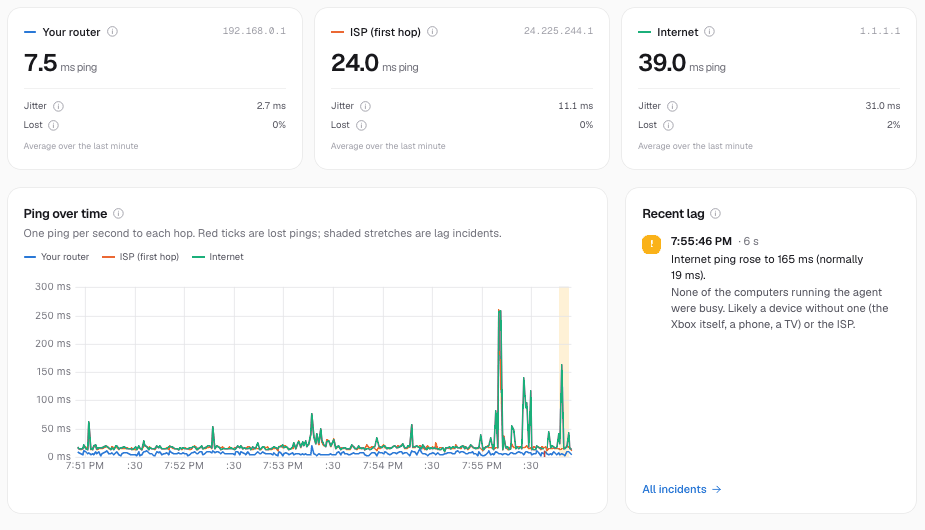
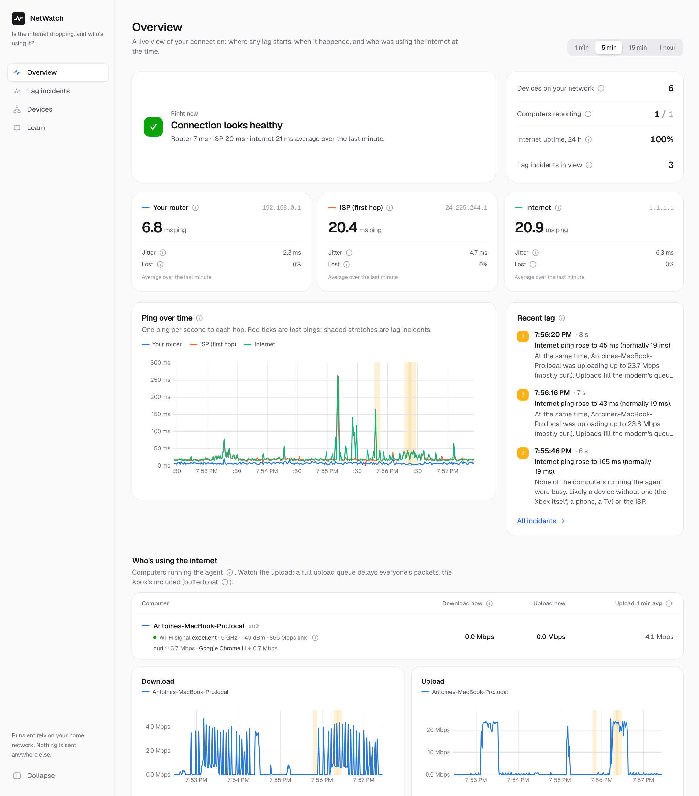
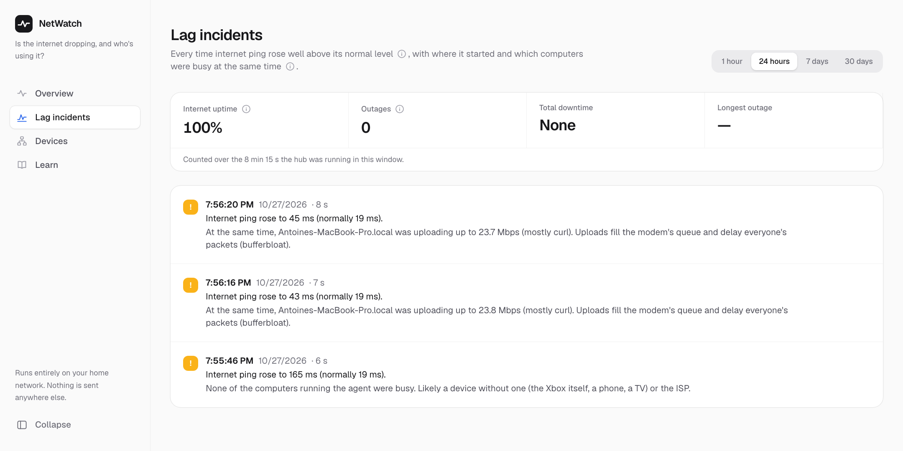
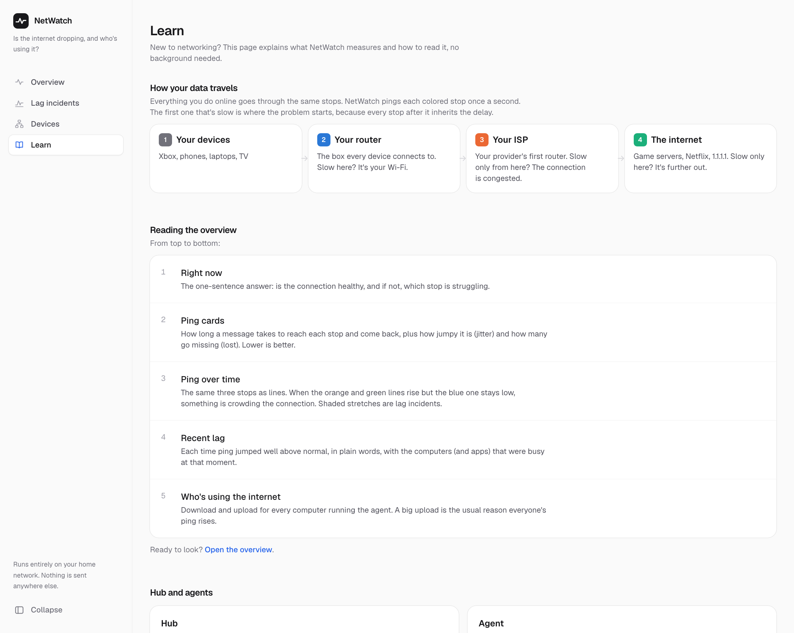
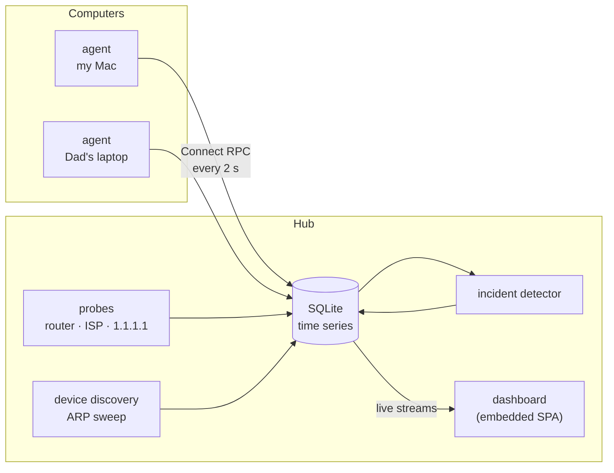

# NetWatch

[](https://github.com/AntoineOparin/netwatch/actions/workflows/ci.yml)

**"Is my home internet dropping, and which device is hogging the bandwidth?"**

I built NetWatch to answer one question: *when my Xbox lags, is it the Wi-Fi, the internet, or someone in the house maxing out the connection?* It watches the connection from inside the home network, catches lag as it happens, and says what was busy at that moment.



<sub>Recorded on my home network: an upload from my Mac pushes internet ping from 19 ms to 45 ms, and NetWatch explains it. (Captured with `-lag-rise 15`, the sensitive setting; the default only flags rises of 30 ms or more, and my modem kept this one smaller than that.)</sub>

## What it tells you

- **Where lag comes from.** It pings the router, the ISP's first router and the internet once a second. If the router is slow too, it's the Wi-Fi. If only the hops past it are slow, it's the connection.
- **When it happened, and who was busy.** Lag incidents are detected automatically and explained in a sentence: *"Internet ping rose to 81 ms (normally 19 ms). At the same time, Dads-Laptop was uploading up to 23.5 Mbps (mostly OneDrive)."*
- **Whether it actually dropped.** Outages (the internet stopped answering entirely) are told apart from slowdowns, with uptime over the last day, week or month.
- **Who's using the internet right now:** per computer, and per app on macOS, plus each computer's Wi-Fi signal strength.
- **Every device on the network**, the Xbox, phones and TV included: name, maker, and an hour of its ping next to the router's, which shows whether its own Wi-Fi link is the weak spot.

<picture>
  <source media="(prefers-color-scheme: dark)" srcset="docs/screenshots/overview-dark.png">
  
</picture>

| Lag incidents, uptime and outages | Learn: the concepts, for non-experts |
|---|---|
|  |  |

## Quick start

Download the binaries for your system from **[Releases](https://github.com/AntoineOparin/netwatch/releases)**, or build them (Go 1.24+ and Bun):

```sh
cd web && bun install && cd ..
make                                   # bin/hub (dashboard included) and bin/agent
```

Then:

```sh
./bin/hub                              # on one machine: dashboard at http://<its-ip>:8080
./bin/agent -hub http://<hub-ip>:8080  # on each computer you want numbers for
```

That's it. Open the dashboard from any device on the network, phones included. **[docs/running.md](docs/running.md)** covers which file to download, Windows, starting at log-in, and the macOS and Windows "unverified developer" prompts.

## Hub and agents

- **The hub** is the one program you need. Run it on one machine and it measures lag (pings to the router, the ISP and the internet), discovers every device on the network, detects incidents, stores history (SQLite) and serves the dashboard.
- **An agent** is a small helper you run on each *computer* you want per-computer numbers for. It reads that computer's network counters (and, on macOS, which apps are using the network) and reports them to the hub every 2 seconds. Without agents you still get lag detection and the device list; with them you also learn *who* was busy.

Consoles, phones and TVs can't run an agent, so they appear in the device list but their traffic isn't measured. See [what it can't see](#what-it-cant-see-yet).



## How it works

| Piece | What it does |
|---|---|
| **Lag probe** | Hand-written ICMP pinger (no root on macOS). Finds the ISP's first router traceroute-style, by limiting how many routers a ping may cross (TTL) |
| **Throughput** | Each agent reads its uplink interface's byte counters once a second; the hub corrects for clock differences between computers |
| **Per-app** (macOS) | `nettop` in delta mode, run under a pseudo-terminal (a pipe made it buffer samples for tens of seconds); processes grouped by their `.app` |
| **Device discovery** | Pings every address so the OS resolves it with ARP, then reads the ARP table: devices that ignore ping still show up. Maker from the MAC (IEEE OUI), names from the router's DNS |
| **Storage** | SQLite with hard ceilings: raw samples 24 h, per-minute rollups 30 days, per-hour rollups and incidents 1 year, unseen devices forgotten after 90 days. It levels off around 100 MB. |
| **Incident detector** | Median baseline, median-of-3 smoothing, hysteresis; Wi-Fi vs upstream from the router's ping; suspects by peak upload/download |
| **Dashboard** | React Router (SPA mode), uPlot charts, live server-streaming RPCs; built into the hub binary with `go:embed` |

**Stack:** Go for the agent and hub (single static binaries, cross-compiled for macOS, Windows, Linux and Raspberry Pi) · Connect RPC + protobuf (schema-first, generated Go and TypeScript clients) · SQLite (pure Go) · React Router, Tailwind and uPlot.

## What I learned

Each milestone has a write-up of the networking and design ideas behind it, with measurements from my own network:

1. [Skeleton](docs/learning/01-skeleton.md): schema-first APIs, heartbeats and soft state, shipping a web UI inside a Go binary
2. [Lag probe](docs/learning/02-lag-probe.md): ICMP, TTL and how traceroute works, jitter, bufferbloat
3. [Throughput](docs/learning/03-throughput.md): interface counters, clock skew, time-series rollups
4. [Lag explainer](docs/learning/04-lag-explainer.md): baselines, hysteresis, correlation vs causation, and what my modem does under load
5. [Every device on the LAN](docs/learning/05-lan-devices.md): layer 2 vs layer 3, private MAC addresses, why phones answer slowly
6. [Which app](docs/learning/06-per-app.md): per-process accounting on each OS, and a buffered-pipe bug
7. [Wi-Fi, outages, device ping](docs/learning/07-health.md): dBm, telling a drop from a slowdown, measuring uptime honestly

## What it can't see (yet)

A computer on a home network only sees its own traffic, and my ISP router (a Fizz/Hitron CODA-4680) has no API for per-device stats. So:

| | Lag | Present on the network | Wi-Fi quality | Its own traffic |
|---|---|---|---|---|
| Computers with an agent | ✓ | ✓ | ✓ | ✓ (per app on macOS) |
| Xbox, phones, TV | ✓ | ✓ | ✓ if it answers ping | ✗ |

When lag hits and no computer with an agent was busy, NetWatch says so and points at the devices it can't measure. Exact traffic for every device needs a vantage point that sees all of it: a Raspberry Pi acting as the gateway, or a router with per-device stats (e.g. OpenWrt). The collector interface is ready for that as one more data source.

## Development

```sh
go run ./cmd/hub &        # API on :8080
cd web && bun run dev     # dashboard with hot reload on :5173, proxied to :8080
```

`make check` runs Go tests (with the race detector), vet, Biome lint, TypeScript typecheck and the web unit tests. `make gen` regenerates code after editing `proto/`, and `make release` builds every platform into `dist/`. CI runs all of it on every push, and pushing a `v*` tag publishes a release.

## Roadmap

- [x] **M1 Skeleton**: agents register and report, the dashboard is embedded in the hub
- [x] **M2 Lag probe**: RTT, jitter and loss to the router, the ISP and 1.1.1.1
- [x] **M3 Who's using bandwidth**: per-computer download and upload, stored in SQLite
- [x] **M4 Lag explainer**: incidents, Wi-Fi vs upstream, and who was busy
- [x] **M5 Every device on the LAN**: discovery, maker, names, LAN ping
- [x] **M6 Per-app breakdown** (macOS)
- [x] **Health metrics**: Wi-Fi signal per computer, outages and uptime, per-device ping charts
- [ ] Per-app on Windows (ETW, needs admin)
- [ ] **M7 Whole-LAN bytes**: Raspberry Pi as gateway, real traffic for the Xbox, phones and TV

## License

[MIT](LICENSE)
