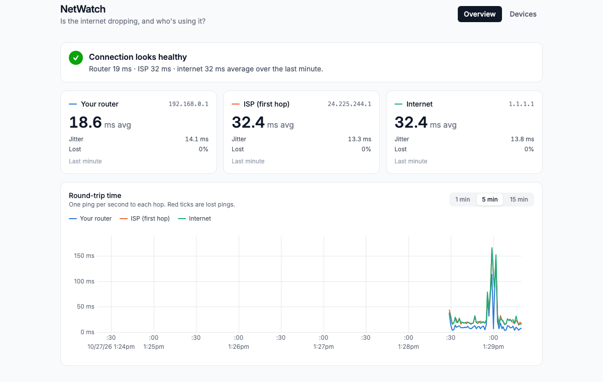

# NetWatch

> "Is my home internet dropping, and which device is hogging the bandwidth?"

A small home-network monitor I'm building to answer one question: **when my Xbox lags, is it the internet, the Wi-Fi, or someone in the house maxing out the connection?**

- **Agents** run on each computer and report what that machine is doing.
- **The hub** collects agent reports, probes latency, discovers every device on the LAN, and serves a dashboard.

```
 [agent: my Mac]   [agent: Dad's laptop]       [hub]
        \________ Connect RPC ________/          |  latency probes, LAN discovery
                        v                        v
              ingest -> store -> analysis -> dashboard (React Router SPA, embedded in the hub binary)
```



## Stack

- **Go**: agent and hub. Each is a single static binary that cross-compiles to macOS, Windows, Linux and Raspberry Pi.
- **Connect RPC + protobuf**: a schema-first agent↔hub API (`proto/`). It generates both the Go server/client and the TypeScript client.
- **React Router (SPA mode) + Tailwind**: the dashboard. It's built to static files and embedded into the hub with `go:embed`.

## Running it

Requirements: Go 1.24+ and Bun.

```sh
cd web && bun install && cd ..
make            # builds bin/hub (with the dashboard inside) and bin/agent

./bin/hub                                   # dashboard on http://localhost:8080
./bin/agent -hub http://<hub-ip>:8080       # on each computer
```

Development, with UI hot reload:

```sh
go run ./cmd/hub &                # API on :8080
cd web && bun run dev             # UI on :5173, proxies RPCs to :8080
```

The hub pings your router, the first ISP hop and 1.1.1.1. Both are detected automatically; override them with `-probe-gateway`, `-probe-isp` (or `off`) and `-probe-internet`. On Linux, unprivileged ping needs `net.ipv4.ping_group_range` to include your group; otherwise run with `-probe-privileged` as root.

Other targets: `make test`, `make check` (tests + vet + lint + typecheck), `make gen` (after editing `proto/`), `make cross` (agent builds for every OS).

## Roadmap

- [x] **M1 Skeleton**: agents register and heartbeat, the hub lists them, and the dashboard is embedded in the binary
- [x] **M2 Lag probe**: RTT, jitter and loss to the gateway, the ISP and 1.1.1.1 (tells Wi-Fi problems apart from internet problems)
- [ ] **M3 Who's using bandwidth**: per-computer upload/download, stored as a time series
- [ ] **M4 Lag explainer**: when latency spikes, show whose traffic spiked at the same moment
- [ ] **M5 Every device on the LAN**: ARP/mDNS discovery, vendor lookup, the Xbox's own LAN ping
- [ ] **M6 Per-process breakdown**: answers which app is uploading
- [ ] **M7 Whole-LAN bytes (Raspberry Pi)**: real per-device traffic for consoles, phones and TVs

## Why it can't just see the Xbox's traffic (yet)

A normal computer on a home network only sees its own packets. My ISP router (a Fizz/Hitron CODA-4680) has no API that exposes per-device stats. So until M7:

- Agents measure the computers directly.
- The hub measures *lag* directly.
- Consoles, phones and TVs are discovered and pinged, but their byte counts aren't measured.

The data sources sit behind a pluggable collector interface, so a Pi-based capture source can be added later without touching storage or the UI.

Notes on what each milestone taught me are in [`docs/learning/`](docs/learning).
